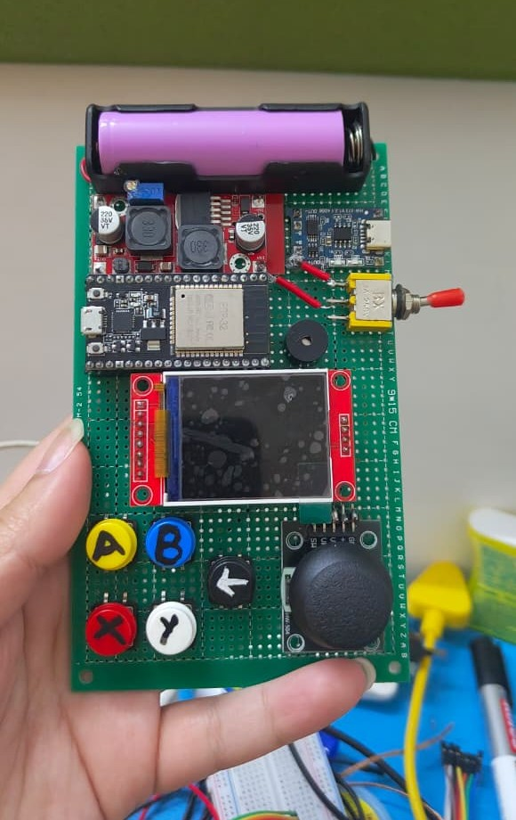

# Meantendo

<p align="center">
  
</p>

<p align="center">
  <strong>A DIY ESP32 Handheld Gaming Console, BLE Controller & Low-Latency Wireless Arcade System</strong><br>
  <em>14 Games & Demos · Zero-Lag Smart Snapback Filter · Sub-2ms ESP-NOW Multiplayer · Native Xbox BLE Pad · Hardware Cryptographic Journaling</em>
</p>

<p align="center">
  <a href="https://www.arduino.cc/"></a>
  <a href="https://platformio.org/"></a>
  <a href="https://www.espressif.com/en/products/socs/esp32"></a>
  <a href="docs/PATENT_SPECIFICATION.md"></a>
  <a href="LICENSE"></a>
</p>

---

## 📜 Intellectual Property & Patent Status

> **Title of Invention:** *An Apparatus and Method for Kinematic Transducer Signal Conditioning and Deterministic Ad-Hoc RF Telemetry in an Embedded Interactive Controller*  
> **Jurisdiction:** Indian Patent Office (IPO) / Form 2 Complete & Provisional Specification Ready  
> **Classification:** `G06F 3/02`, `G06F 3/0338`, `H04W 4/00`, `H04L 67/12`

Meantendo incorporates four core hardware/firmware inventions engineered from first principles:
1. **Smart Snapback Kinematic Conditioning Engine:** Real-time finite-difference velocity calculation ($v = \Delta x / \Delta t$) and zero-crossing detection that clamps mechanical thumbstick spring recoil for 50ms while preserving **0ms lag for outward human player strokes**.
2. **Deterministic Ad-Hoc RF Telemetry & Coexistence Channel Lock:** Sub-2ms 60 Hz bidirectional game state and input synchronization over direct unassociated 802.11 action frames (ESP-NOW Channel 1) with automatic frequency-lock recovery post-cloud roaming.
3. **Zero-Buffer Dual Line-Buffer Raster Engine:** Composites scanlines line-by-line using dual 320-byte buffers (640 bytes total vs 40,960 bytes for full framebuffer, saving **98.4% RAM**), paired with a bounded dirty-span queue reducing SPI bus load by up to **90%**.
4. **Hardware-Anchored Cryptographic Tournament Journaling:** Hardware TRNG salt and hardware-accelerated SHA-256 block hashing certifying game execution and high scores against offline memory tampering.

* Full Technical & Legal Claims Dossier: [**docs/PATENT_SPECIFICATION.md**](docs/PATENT_SPECIFICATION.md)
* University IPR Cell Submission Form: [**docs/Meantendo_University_Patent_Submission.docx**](docs/Meantendo_University_Patent_Submission.docx)

---

## Demo

[](https://www.youtube.com/shorts/cb1YR2BpdeY)

---

## Features

### 🕹️ Games & Demos (14 Built-In Applications)
- **Playable Games:** Snake, Pong (1P vs AI / 2P Wireless Mesh), Tetris, Flappy Bird, Asteroids, Breakout, Conway's Game of Life.
- **Visual Demos & Physics:** Matrix Rain, Kaleidoscope, Maze Solver, Dynamic Particles, Mandelbrot/Julia Fractals, Slime Simulator (Physarum polycephalum).
- **Embedded Tools:** System Diagnostics Lab (live radar visualizer, telemetry monitor, crypto seal validator), Bluetooth Pad HUD, Cloud OTA Updater.

### ⚡ Quad-Engine Architecture
- **Kinematic Transducer Conditioning:** Eliminates mechanical snapback overshoot on cheap potentiometers without analog RC low-pass delays or oversized deadzones.
- **Sub-2ms Deterministic Peer-to-Peer Mesh:** Direct ESP-NOW multiplayer on Channel 1 without routers, pairing delays, or TCP/IP overhead. Supports heterogeneous master-coprocessor state machines.
- **Native Bluetooth Low Energy Gamepad:** Emulates an Xbox/Standard Gamepad over BLE with paced 8ms reporting, automatic reconnection latches, and clean peripheral disconnects.
- **Dual-Line Zero-Buffer Display Pipeline:** 640-byte ping-pong scanline streaming on 27MHz SPI, freeing 40KB+ SRAM for concurrent Bluetooth, Wi-Fi, and game logic.
- **10µA Deep Sleep Persistence:** Game registers and high scores preserved in internal 8KB RTC Fast/Slow memory, with instant-on 38ms resumption via Button A interrupt.
- **GitHub Cloud OTA Updates:** Over-The-Air firmware updates directly from GitHub Releases via `WiFi & Update`, automatically falling back to locked peer-to-peer radio channels upon completion.

---

## Hardware Architecture

| Component | Specification | Role |
|---|---|---|
| **Microcontroller** | ESP32 Dev Module (38-pin, NodeMCU) | 240MHz Dual-Core Xtensa LX6, 520KB SRAM, 4MB Flash |
| **Display Panel** | 1.8" ST7735 TFT (160×128, 16-bit RGB565) | Hardware SPI @ 27MHz, driven by line-buffer raster engine |
| **Analog Transducer** | 2-Axis Resistive Gimbal (B10K Potentiometers) | Dual 12-bit SAR ADC (GPIO 34/35), conditioned by SmartSnapbackEngine |
| **Tactile Buttons** | 6 Tactile Switches (A, B, X, Y, Select, Back) | Digital inputs with internal pull-ups and hardware sleep interrupt |
| **Audio Peripheral** | Passive Buzzer (3.3V) | Non-blocking dynamic LEDC PWM tones |
| **Companion Node** | Secondary ESP32 DevKit (or ESP32-S2) | Autonomous P2P multiplayer peer, Auto-Bot AI, and PC Serial bridge |

* See [**docs/BOM.md**](docs/BOM.md) for the full component bill and purchasing links.
* See [**docs/wiring_guide.md**](docs/wiring_guide.md) for exact pin connections and schematic layout.

---

## Getting Started

### Prerequisites
- [PlatformIO Core](https://docs.platformio.org/page/core.html) or [PlatformIO IDE](https://platformio.org/install/ide?install=vscode) (VS Code Extension)
- ESP32 toolchain (automatically managed by PlatformIO)
- USB-to-MicroUSB data cables

### Installation & Flashing

```bash
# Clone the repository
git clone https://github.com/Debyte404/Meantendo.git
cd Meantendo

# 1. Build and Flash the Primary Handheld Console
pio run -e esp32dev --target upload

# 2. Monitor primary console serial output
pio device monitor -e esp32dev

# 3. Flash the Secondary Companion Node (on its respective COM port, e.g. COM11)
pio run -d companion -e esp32dev --target upload
```

> **Tip:** If flashing fails due to SPI bus conflict, briefly disconnect the TFT display's CS line (GPIO 5) during the upload sequence.

* For complete verification steps and system self-tests, consult [**docs/TESTING_GUIDE.md**](docs/TESTING_GUIDE.md).
* For cloud update instructions, consult [**docs/OTA_UPDATE_GUIDE.md**](docs/OTA_UPDATE_GUIDE.md).

---

## Project Structure

```
Meantendo/
├── src/
│   ├── main.cpp                  # System boot, hardware self-test, menu loop
│   ├── core/                     # Core Firmware Engines
│   │   ├── Config.hpp            # Firmware versioning & Cloud OTA endpoints
│   │   ├── Display.hpp           # TFT SPI bus configuration & pin definitions
│   │   ├── Input.hpp             # Transducer sampling & button debounce
│   │   ├── SnapbackEngine.hpp    # Smart Snapback kinematic velocity filter
│   │   ├── SnapbackEngine.cpp    # Global filter instance
│   │   ├── Wireless.hpp          # Sub-2ms ESP-NOW telemetry & Channel 1 lock
│   │   ├── Wireless.cpp          # Bidirectional game state broadcast
│   │   ├── RasterEngine.hpp      # Zero-framebuffer line raster & dirty spans
│   │   ├── RasterEngine.cpp      # Global raster engine instance
│   │   ├── PowerStateEngine.hpp  # 8KB RTC memory persistence & 10µA deep sleep
│   │   ├── PowerStateEngine.cpp  # Sleep state save/restore implementation
│   │   ├── CryptoJournal.hpp     # Hardware TRNG + SHA-256 execution journal
│   │   ├── CryptoJournal.cpp     # Anti-tamper chained block hashing
│   │   ├── CloudUpdater.hpp      # GitHub Releases HTTPS OTA update engine
│   │   ├── CloudUpdater.cpp      # Partition streaming & SHA verification
│   │   ├── Buzzer.hpp & .cpp     # Non-blocking audio feedback
│   │   ├── Game.hpp              # GameDef registry
│   │   ├── Menu.hpp              # Animated categorized menu system
│   │   ├── SelfTest.hpp          # Automated boot diagnostic test suite
│   │   └── Splash.hpp            # Fade-in/out logo animation
│   └── games/                    # 14 Built-In Applications
│       ├── Snake.cpp             # Snake with crypto high-score sealing
│       ├── Pong.cpp              # 1P AI & 2P true peer-to-peer wireless mesh
│       ├── Tetris.cpp
│       ├── Breakout.cpp
│       ├── Asteroids.cpp
│       ├── FlappyBird.cpp
│       ├── GameOfLife.cpp
│       ├── BluetoothPad.cpp      # Native Xbox/Standard BLE Gamepad
│       ├── WirelessPad.cpp       # ESP-NOW live RF telemetry HUD
│       ├── WifiUpdaterApp.cpp    # On-console Cloud OTA update interface
│       ├── SystemTools.cpp       # System Diagnostics Lab (Radar, Sleep, Mesh)
│       ├── Kaleidoscope.cpp
│       ├── MatrixRain.cpp
│       ├── MazeSolver.cpp
│       ├── Particles.cpp
│       ├── Fractals.cpp
│       └── SlimeSim.cpp
├── companion/                    # Dedicated Multiplayer Companion Node
│   ├── platformio.ini            # Multi-environment configuration
│   └── src/
│       └── main_companion.cpp    # P2P Node: Auto-Bot AI, ASCII court & Serial WASD
├── assets/                       # High-resolution hardware photographs
├── docs/                         # Technical Documentation & Patent Dossier
│   ├── PATENT_SPECIFICATION.md   # Complete Indian/US Patent Specification & Claims
│   ├── Meantendo_University_Patent_Submission.docx # University IPR submission document
│   ├── BOM.md                    # Bill of materials
│   ├── wiring_guide.md           # Hardware pinout & wiring diagram
│   ├── TESTING_GUIDE.md          # Step-by-step verification guide
│   └── OTA_UPDATE_GUIDE.md       # Over-the-air update guide
├── platformio.ini                # Console build configuration (C++17)
└── README.md
```

---

## Controls

| Control | In-Menu Action | In-Game Action |
|---|---|---|
| **Analog Thumbstick** | Up/Down menu navigation (Snapback-filtered) | Kinematic directional movement |
| **Button A (GPIO 32)** | Select / Confirm | Primary Action / Jump / Fire |
| **Button B (GPIO 33)** | Cancel / Back | Secondary Action / Cancel |
| **Button X (GPIO 26)** | Toggle System Tools | Special Action (e.g. Player 2 UP) |
| **Button Y (GPIO 27)** | Quick Sleep / Standby | Special Action (e.g. Player 2 DOWN) |
| **Select (GPIO 14)** | Alternate Confirm | Pause / Status |
| **Back (GPIO 13)** | Return to Main Menu | Immediate exit to Menu |

---

## Credits & Third-Party Libraries

Engineered by **Debyte**

Third-party open-source libraries used under permissive licenses:
- [Adafruit GFX](https://github.com/adafruit/Adafruit-GFX-Library) (BSD License)
- [Adafruit ST7735](https://github.com/adafruit/Adafruit-ST7735-Library) (BSD License)
- [ESP32-BLE-Gamepad by lemmingDev](https://github.com/lemmingDev/ESP32-BLE-Gamepad) (MIT License)
- [NimBLE-Arduino by h2zero](https://github.com/h2zero/NimBLE-Arduino) (Apache 2.0 License)
- [WebSockets by Markus Sattler](https://github.com/Links2004/arduinoWebSockets) (LGPL 2.1)
- [Arduino Core for ESP32 by Espressif](https://github.com/espressif/arduino-esp32) (LGPL 2.1)

---

## License

This project is licensed under the **MIT License** — see the [LICENSE](LICENSE) file for details.  
*All rights regarding proprietary patent claims and technical specifications are reserved per applicable intellectual property statutes.*
