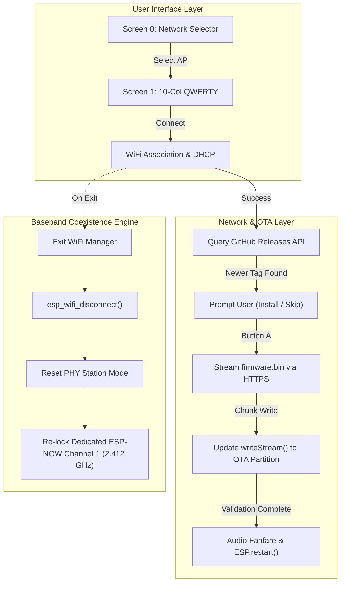
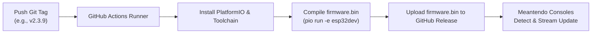
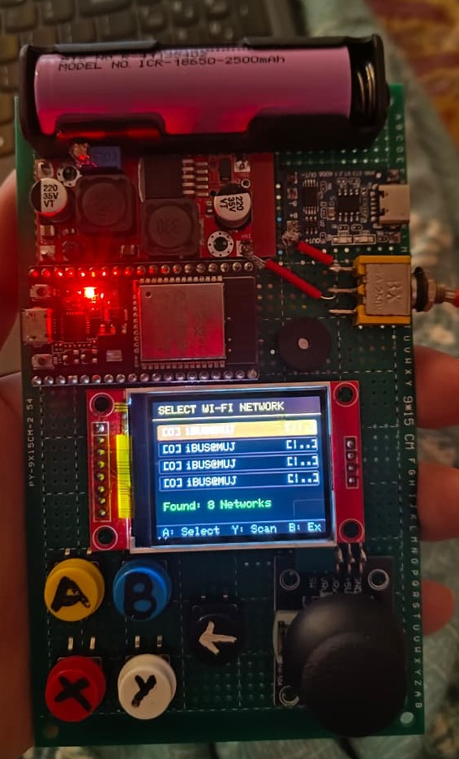
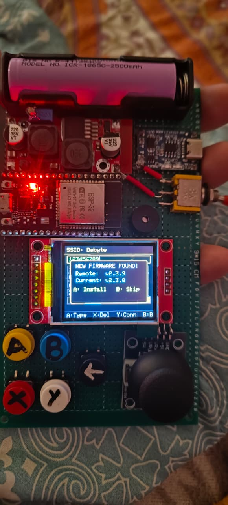
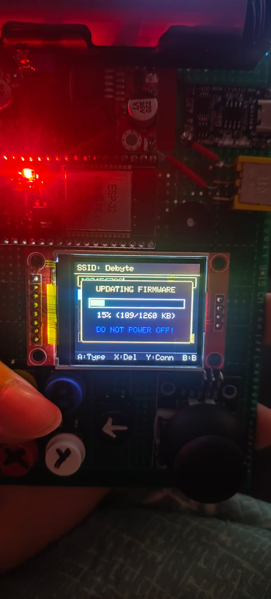

# Meantendo Cloud OTA & Full-Width TV Wi-Fi Manager

This guide details the operation, interface architecture, and technical mechanics of the **WiFi & Cloud Update** subsystem (`src/games/WifiUpdaterApp.cpp` and `src/core/CloudUpdater.cpp`). Meantendo features a full-width two-screen TV interface designed for 160×128 ST7735 displays, an on-screen 10-column QWERTY keyboard with physical controller shortcuts, and an automated over-the-air (OTA) cloud update engine directly integrated with GitHub Releases (`https://github.com/Debyte404/Meantendo`).

---

## 1. Full-Width Two-Screen Architecture Overview

Rather than cramming lists and keys into a narrow split-screen layout, Meantendo implements a **Two-Screen Staged Flow** that utilizes the entire 160×128 pixel display area:

```
┌────────────────────────────────────────────────────────┐
│                   SCREEN FLOW PIPELINE                 │
│                                                        │
│  [Screen 0: Network Selector]                          │
│          │                                             │
│          ▼ (Press A on highlighted SSID)               │
│  [Screen 1: Full-Width 10-Col QWERTY TV Keyboard]      │
│          │                                             │
│          ▼ (Press Y or select CONNECT)                 │
│  [Connecting Modal & GitHub Release Query]             │
│          │                                             │
│          ▼ (If newer release detected)                 │
│  [Screen 2: Firmware Update Prompt & Live OTA Flash]   │
└────────────────────────────────────────────────────────┘
```

---

## 2. Screen 0: Wi-Fi Network Selector (`STATE_NETWORKS_LIST`)

The network discovery screen scans the 2.4 GHz RF environment and displays visible access points in a scrollable, high-contrast list.

```
┌────────────────────────────────────────────────────────┐
│ SELECT WI-FI NETWORK                                   │ ← Header (Cyan accent)
├────────────────────────────────────────────────────────┤
│ [L] MyHomeWiFi     [|||]                               │ ← Active Selection (Blue Pill)
│ [L] Office_5G      [||.]                               │ ← [L] = Encrypted / WPA2
│ [O] GuestCafenet   [|..]                               │ ← [O] = Open Network
│ [L] Hotspot_4G     [|||]                               │ ← 3-Tier RSSI Signal Bars
│                                                        │
├────────────────────────────────────────────────────────┤
│ Found: 4 Networks                                      │ ← Dedicated Status Band (y=90)
├────────────────────────────────────────────────────────┤
│ A: Select  Y: Scan  B: Exit                            │ ← Control Footer
└────────────────────────────────────────────────────────┘
```

### Visual Elements:
- **Header:** High-contrast bar with glowing cyan underline (`SELECT WI-FI NETWORK`).
- **Network Slots:** Displays 4 visible networks simultaneously (`VISIBLE_NETWORKS = 4`) with smooth vertical viewport scrolling.
- **Security Badge:**
  - `[L]`: WPA/WPA2/WPA3 Encrypted network.
  - `[O]`: Open network (no password required).
- **SSID Name:** Truncated cleanly to 14 characters to prevent horizontal overflow.
- **Signal Strength (RSSI) Indicator:**
  - `[|||]`: Excellent signal (`RSSI > -60 dBm`).
  - `[||.]`: Good signal (`RSSI > -75 dBm`).
  - `[|..]`: Weak signal (`RSSI <= -75 dBm`).
- **Active Selection:** Highlighted with a vibrant blue rounded pill (`#0078C8`) and bold white text.
- **Status Band (y = 90):** Displays real-time scan feedback (`Scanning 2.4GHz RF...`, `Found: X Networks`, or `No APs detected`).
- **Footer:** Persistent command bar (`A: Select  Y: Scan  B: Exit`).

### Navigation & Controls:
- **Analog Stick / D-Pad (Up / Down):** Scroll through the scanned network list with automatic viewport tracking.
- **Button A:** Select the highlighted SSID and transition to Screen 1 (TV Keyboard). If connecting to a previously saved network, the stored password is automatically populated; otherwise, a clean input field is presented.
- **Button Y:** Trigger an asynchronous 2.4 GHz RF background scan (`WiFi.scanNetworks(true)`).
- **Button B / BACK:** Exit the Wi-Fi tool and return to the Meantendo main menu.

---

## 3. Screen 1: Full-Width 10-Column QWERTY TV Keyboard (`STATE_KEYBOARD_ENTRY`)

A 10-column, 5-row interactive on-screen keyboard engineered specifically for gamepad controllers.

```
┌────────────────────────────────────────────────────────┐
│ SSID: MyHomeWiFi                                       │ ← Target SSID Header
│ ┌────────────────────────────────────────────────────┐ │
│ │ MySecretPassword_                                  │ │ ← Password Box (Green + Blink Cursor)
│ └────────────────────────────────────────────────────┘ │
│ [ 1 ][ 2 ][ 3 ][ 4 ][ 5 ][ 6 ][ 7 ][ 8 ][ 9 ][ 0 ]     │ ← Row 0: Digits
│ [ Q ][ W ][ E ][ R ][ T ][ Y ][ U ][ I ][ O ][ P ]     │ ← Row 1: Top QWERTY
│ [ A ][ S ][ D ][ F ][ G ][ H ][ J ][ K ][ L ][   ]     │ ← Row 2: Home QWERTY + Space
│ [ Z ][ X ][ C ][ V ][ B ][ N ][ M ][ - ][ . ][ @ ]     │ ← Row 3: Bottom QWERTY + Symbols
│ [  ABC  ]   [  DEL  ]   [  CLR  ]   [   CONNECT   ]    │ ← Row 4: Action Command Buttons
├────────────────────────────────────────────────────────┤
│ A:Type  X:Del  Y:Conn  B:Back                          │ ← Control Footer
└────────────────────────────────────────────────────────┘
```

### Keyboard Matrix Specification:

| Row | Col 0 | Col 1 | Col 2 | Col 3 | Col 4 | Col 5 | Col 6 | Col 7 | Col 8 | Col 9 | Function |
|:---:|:---:|:---:|:---:|:---:|:---:|:---:|:---:|:---:|:---:|:---:|:---|
| **Row 0** | `1` | `2` | `3` | `4` | `5` | `6` | `7` | `8` | `9` | `0` | Number row |
| **Row 1** | `Q` / `q` | `W` / `w` | `E` / `e` | `R` / `r` | `T` / `t` | `Y` / `y` | `U` / `u` | `I` / `i` | `O` / `o` | `P` / `p` | Upper / Lower QWERTY |
| **Row 2** | `A` / `a` | `S` / `s` | `D` / `d` | `F` / `f` | `G` / `g` | `H` / `h` | `J` / `j` | `K` / `k` | `L` / `l` | `_` (Space) | Home Row + Space |
| **Row 3** | `Z` / `z` | `X` / `x` | `C` / `c` | `V` / `v` | `B` / `b` | `N` / `n` | `M` / `m` | `-` | `.` | `@` | Bottom Row + Punctuation |
| **Row 4** | `[ABC]` (Cols 0-1) | `[DEL]` (Cols 2-3) | `[CLR]` (Cols 4-5) | `[CONNECT]` (Cols 6-9, 56px wide) | Mode / Del / Clear / Submit |

### Gamepad Controller Shortcuts:
- **Analog Stick / D-Pad:** 2D grid navigation with horizontal and vertical wrap-around.
- **Button A:** Types the highlighted character, or activates the focused action button.
- **Button X (Instant Backspace):** Deletes the preceding character immediately without navigating to the `DEL` button.
- **Button SELECT (Instant Shift):** Cycles between uppercase (`ABC`) and lowercase (`abc`) character matrices.
- **Button Y (Instant Connect):** Immediately initiates Wi-Fi association and credential storage from anywhere on the keyboard grid.
- **Button B:** Cancels password entry and returns to the Network Selector.

---

## 4. Connection, GitHub Checking & OTA Flashing Modals

### 4.1 Connecting & IP Acquisition Modal
When connection is triggered, Meantendo displays a centered modal dialog while handling 802.11 association and DHCP lease acquisition:

```
┌────────────────────────────────────────────────────────┐
│                                                        │
│        ┌──────────────────────────────────────┐        │
│        │ CONNECTING WI-FI...                  │        │
│        │ MyHomeWiFi                           │        │
│        │ Associating & DHCP...                │        │
│        └──────────────────────────────────────┘        │
│                                                        │
└────────────────────────────────────────────────────────┘
```

Once connected:
```
┌────────────────────────────────────────────────────────┐
│                                                        │
│        ┌──────────────────────────────────────┐        │
│        │ WI-FI CONNECTED!                     │        │
│        │ IP: 192.168.1.42                     │        │
│        │ Checking GitHub...                   │        │
│        └──────────────────────────────────────┘        │
│                                                        │
└────────────────────────────────────────────────────────┘
```

### 4.2 Firmware Update Detection Prompt (`STATE_UPDATE_PROMPT`)
Meantendo queries the GitHub Releases API (`https://api.github.com/repos/Debyte404/Meantendo/releases/latest`) and compares the remote semantic tag against `MEANTENDO_VERSION` (`v2.3.9`):

```
┌────────────────────────────────────────────────────────┐
│                                                        │
│       ┌────────────────────────────────────────┐       │
│       │ NEW FIRMWARE FOUND!                    │       │
│       │ Remote:  v2.4.0                        │       │
│       │ Current: v2.3.9                        │       │
│       │                                        │       │
│       │ A: Install   B: Skip                   │       │
│       └────────────────────────────────────────┘       │
│                                                        │
└────────────────────────────────────────────────────────┘
```
- **Button A:** Authorize installation and begin streaming partition flashing.
- **Button B:** Skip update and return to the network manager.

### 4.3 Streaming Partition Flasher (`STATE_FLASHING_OTA`)
During update streaming, Meantendo writes the incoming binary chunks directly into the inactive OTA application partition:

```
┌────────────────────────────────────────────────────────┐
│                                                        │
│       ┌────────────────────────────────────────┐       │
│       │          UPDATING FIRMWARE             │       │
│       │ ┌────────────────────────────────────┐ │       │
│       │ │██████████████████                  │ │       │
│       │ └────────────────────────────────────┘ │       │
│       │            58% (720/1240 KB)           │       │
│       │           DO NOT POWER OFF!            │       │
│       └────────────────────────────────────────┘       │
│                                                        │
└────────────────────────────────────────────────────────┘
```
- **Progress Gauge:** Real-time visual progress bar (`ST77XX_GREEN`).
- **Telemetry Counter:** Downloaded bytes and total binary size displayed in kilobytes.
- **Safety Lockout:** Red warning `DO NOT POWER OFF!` displayed until flash verification completes.
- **Reboot & Verification:** Upon successful checksum validation, Meantendo plays an audio confirmation tone and calls `ESP.restart()`, booting cleanly into the new firmware.

### 4.4 Error Handling Modals
If association or flashing encounters an error, a high-visibility error modal indicates the exact failure cause:
- **`Error: Wrong Password`**: 802.11 handshake authentication failed.
- **`Error: AP Not Found`**: SSID not responding or out of range.
- **`Error: Timeout / Reject`**: DHCP lease acquisition or router connection timed out.
- **`OTA FLASH FAILED!`**: Download interrupted or partition checksum mismatch.

---

## 5. Technical Mechanics & Coexistence Engine



### Dual-Role Coexistence:
1. **Infrastructure Mode for OTA:** When entering Wi-Fi updater mode, ESP-NOW hooks are cleanly detached, allowing the 802.11 MAC layer to scan and associate with external standard Wi-Fi access points.
2. **Channel-Lock Recovery for Gaming:** Upon exiting the updater or after firmware flashing, the coexistence engine terminates external IP associations and re-initializes the radio baseband on **dedicated Channel 1 (2.412 GHz)**, ensuring zero-latency peer-to-peer multiplayer packets remain deterministic.

---

## 6. Automated GitHub Actions CI/CD Pipeline

Meantendo includes an automated build-and-release workflow configured at `.github/workflows/build-release.yml`:



### Publishing an Official Update:
1. Increment the version string in [`src/core/Config.hpp`](file:///D:/ValueProjects/Meantendo/Meantendo/src/core/Config.hpp):
   ```cpp
   #define MEANTENDO_VERSION "v2.4.0"
   ```
2. Commit and push a matching Git tag:
   ```bash
   git tag v2.4.0
   git push origin v2.4.0
   ```
3. The GitHub Actions runner compiles the binary and attaches `firmware.bin` to the release.
4. Consoles running previous versions will automatically detect `v2.4.0` on their next Wi-Fi connection.

---

## 7. Serial Terminal Configuration Commands

For development and bench testing, Wi-Fi credentials and system controls can be configured over USB Serial at **115200 baud**:

| Command | Syntax | Description |
|---|---|---|
| `SETWIFI` | `SETWIFI <SSID> <PASSWORD>` | Stores network credentials directly into non-volatile storage (NVS). |
| `SETWIFI` (Open) | `SETWIFI <SSID>` | Stores an open network without a password into NVS. |
| `STATUS` | `STATUS` | Prints firmware version, available heap memory, and connection state. |
| `REBOOT` | `REBOOT` | Restarts the ESP32 console. |

---

## 8. Physical Hardware Verification Gallery

<div align="center">

| Wi-Fi Network Selector | Firmware Update Found Prompt | Streaming Partition Flashing |
| :---: | :---: | :---: |
|  |  |  |
| *Scanning 2.4 GHz infrastructure networks with security and signal indicators* | *Remote GitHub release tag parsed and presented with comparison prompt* | *Real-time partition writing with byte counters and safety lockout* |

</div>
