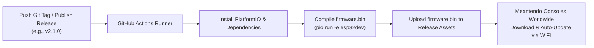

# Meantendo Cloud OTA & TV-Style Wi-Fi Manager

This guide explains how Meantendo scans nearby Wi-Fi networks, inputs passwords using the on-screen smart TV keyboard, and automatically updates firmware over-the-air (OTA) directly from GitHub Releases (`https://github.com/Debyte404/Meantendo`).

---

## 1. Split-Screen Interface Overview

The **WiFi & Cloud Update** tool (`src/games/WifiUpdaterApp.cpp`) features a dual-pane layout designed for 160×128 ST7735 displays:

```
┌────────────────────────────────────────────────────────┐
│ WiFi & Cloud Update                            v2.0.0  │
├──────────────────────────┬─────────────────────────────┤
│ NETWORKS                 │ KEYBOARD [ABC]              │
│ ┌──────────────────────┐ │ [A][B][C][D][E][F]          │
│ │ > MyHomeWiFi     ... │ │ [G][H][I][J][K][L]          │
│ │   CafeGuest      ..  │ │ [M][N][O][P][Q][R]          │
│ │   Hotspot_4G     .   │ │ [S][T][U][V][W][X]          │
│ └──────────────────────┘ │ [Y][Z][0][1][2][3]          │
│ PASSWORD:                │ [a][_][-][@][<][K]          │
│ ┌──────────────────────┐ ├─────────────────────────────┤
│ │ MyPass123_           │ │ ^: Shift/Layout             │
│ └──────────────────────┘ │ _: Space   <: Backspace     │
│ [CONNECTED!]             │ K: OK / Connect             │
│ IP: 192.168.1.42         │                             │
├──────────────────────────┴─────────────────────────────┤
│ A:Type/Select  X:Del  Y:Connect/Scan  B:Back           │
└────────────────────────────────────────────────────────┘
```

---

## 2. Controls & Navigation

### Left Pane: Wi-Fi List & Password
- **Analog Stick / D-Pad (Up / Down)**: Scroll through nearby scanned Wi-Fi SSIDs.
- **Analog Stick (Right) or Button A**: Select the highlighted SSID and move cursor to the TV Keyboard on the right.
- **Button Y**: Trigger a fresh background Wi-Fi scan (`WiFi.scanNetworks()`).
- **Button B / BACK**: Exit to the Meantendo main menu.

### Right Pane: TV On-Screen Keyboard
- **Analog Stick / D-Pad**: Move highlighted selection across the 6×6 key grid.
- **Analog Stick (Left at Col 0) or Button B**: Return focus to the Wi-Fi list on the left.
- **Button A**: Type the highlighted character into the password box.
- **Button X**: Instant backspace / delete last character.
- **Button SELECT**: Cycle keyboard layouts (`[ABC]` Uppercase $\rightarrow$ `[abc]` Lowercase $\rightarrow$ `[123]` Numbers/Symbols).
- **Button Y or Key `K` (OK)**: Save credentials to non-volatile storage (NVS) and initiate connection!

---

## 3. Keyboard Layouts (6×6 Matrix)

### Layout 1: Uppercase & Action Keys `[ABC]`
| Col 0 | Col 1 | Col 2 | Col 3 | Col 4 | Col 5 | Action |
|:---:|:---:|:---:|:---:|:---:|:---:|:---|
| **A** | **B** | **C** | **D** | **E** | **F** | Letters |
| **G** | **H** | **I** | **J** | **K** | **L** | Letters |
| **M** | **N** | **O** | **P** | **Q** | **R** | Letters |
| **S** | **T** | **U** | **V** | **W** | **X** | Letters |
| **Y** | **Z** | **0** | **1** | **2** | **3** | Digits |
| **a** | **_** | **-** | **@** | **<** | **K** | Mode / Space / Dash / At / Del / OK |

### Layout 2: Lowercase `[abc]`
| Col 0 | Col 1 | Col 2 | Col 3 | Col 4 | Col 5 | Action |
|:---:|:---:|:---:|:---:|:---:|:---:|:---|
| **a** | **b** | **c** | **d** | **e** | **f** | Letters |
| **g** | **h** | **i** | **j** | **k** | **l** | Letters |
| **m** | **n** | **o** | **p** | **q** | **r** | Letters |
| **s** | **t** | **u** | **v** | **w** | **x** | Letters |
| **y** | **z** | **4** | **5** | **6** | **7** | Digits |
| **a** | **_** | **.** | **!** | **<** | **K** | Mode / Space / Dot / Excl / Del / OK |

### Layout 3: Symbols & Digits `[123]`
| Col 0 | Col 1 | Col 2 | Col 3 | Col 4 | Col 5 | Action |
|:---:|:---:|:---:|:---:|:---:|:---:|:---|
| **0** | **1** | **2** | **3** | **4** | **5** | Digits |
| **6** | **7** | **8** | **9** | **+** | **-** | Math symbols |
| **\*** | **/** | **=** | **#** | **$** | **%** | Special symbols |
| **&** | **(** | **)** | **[** | **]** | **{** | Brackets |
| **}** | **:** | **;** | **?** | **!** | **~** | Punctuation |
| **a** | **_** | **.** | **,** | **<** | **K** | Mode / Space / Dot / Comma / Del / OK |

---

## 4. How Cloud Auto-Update Works

1. **GitHub Connection**:
   - Once Wi-Fi connects, Meantendo queries:
     `https://api.github.com/repos/Debyte404/Meantendo/releases/latest`
   - It parses the remote `tag_name` (e.g. `v2.1.0`) and compares it against `MEANTENDO_VERSION` (`v2.0.0`).
   - If the API rate limit is reached or unauthenticated, it falls back to inspecting the redirect header from `https://github.com/Debyte404/Meantendo/releases/latest`.

2. **OTA Streaming Installation**:
   - If a newer version is found, an on-screen dialog prompts:
     `UPDATE FOUND: v2.1.0! Press A to Install`
   - When **A** is pressed, Meantendo streams the binary directly from GitHub CDN (`release-assets.githubusercontent.com`) into the inactive OTA app flash partition using `Update.write()`.
   - A live progress bar displays downloaded bytes, total size, and percentage.
   - Upon checksum verification, Meantendo plays a victory buzzer tone and calls `ESP.restart()`, booting cleanly into the new firmware!

---

## 5. Automated GitHub Actions Release Workflow

A workflow has been configured at `.github/workflows/build-release.yml`:



### How to Release an Update:
1. Increment the version in [`src/core/Config.hpp`](file:///D:/ValueProjects/Meantendo/Meantendo/src/core/Config.hpp):
   ```cpp
   #define MEANTENDO_VERSION "v2.1.0"
   ```
2. Commit and tag:
   ```bash
   git tag v2.1.0
   git push origin v2.1.0
   ```
3. GitHub Actions builds `firmware.bin` and attaches it to the release automatically.
4. Turn on Meantendo, go to **WiFi & Cloud Update**, press **Connect**, and it will detect and install the new update!

---

## 6. Serial Setup Commands (Alternative)

If you prefer setting Wi-Fi over USB Serial:
- `SETWIFI <SSID> <PASSWORD>`: Saves network credentials directly to ESP32 NVS.
- `STATUS`: Displays current firmware version, heap memory, and Wi-Fi status.
- `REBOOT`: Restarts the console.
