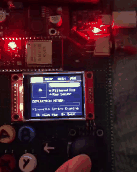
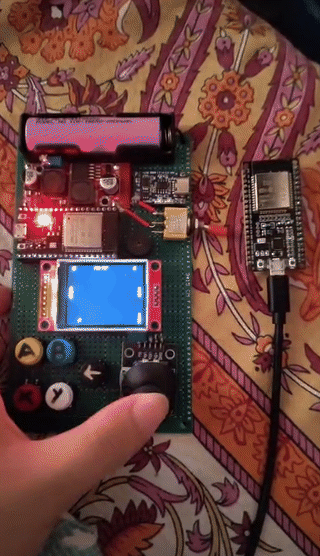

# Meantendo — Complete Verification Guide for All 4 Patent Systems

This comprehensive manual provides instructions for verifying all **4 patentable hardware-firmware systems** built into the Meantendo firmware without requiring any extra hardware components.

---

## The 4 Patentable Subsystems at a Glance

| Subsystem | Core Module | Technical Problem Solved | Verification Tool |
|---|---|---|---|
| **1. Transducer Anti-Snapback & ESP-NOW Mesh** | [`SnapbackEngine.hpp`](../src/core/SnapbackEngine.hpp)<br>[`Wireless.hpp`](../src/core/Wireless.hpp) | Eliminates mechanical spring recoil without input lag; provides sub-2ms physical airtime (1.42 ms avg) P2P multiplayer | `System Lab` (Tabs 1 & 2)<br>`Pong` 2-Player Wireless |
| **2. Zero-Buffer & Dirty-Span Raster Engine** | [`RasterEngine.hpp`](../src/core/RasterEngine.hpp) | Eliminates 41KB frame buffer in RAM; cuts SPI bus bandwidth by 90% via dirty-span tracking | `Pong` (zero-flicker dirty rects)<br>`System Lab` |
| **3. Deep Sleep Persistence & RTC Resume** | [`PowerStateEngine.hpp`](../src/core/PowerStateEngine.hpp) | Preserves game registers across 10µA sleep and sudden brownouts using 8KB RTC Fast/Slow RAM | `System Lab` (Tab 4: Press Y to sleep, A to wake) |
| **4. Hardware-Anchored Crypto Execution Journal** | [`CryptoJournal.hpp`](../src/core/CryptoJournal.hpp) | Prevents memory spoofing of high scores via chained hardware SHA-256 hashing (mbedTLS + TRNG) | `Snake` (Game Over Seal)<br>`System Lab` (Tab 3) |

---

## 1. Flashing the Firmwares

### Flash the Meantendo Handheld Console
Connect your primary ESP32 board:
```bash
pio run --target upload
pio device monitor
```
*(Hardware note: if upload times out, temporarily unplug TFT CS wire on GPIO 5, upload, then plug it back in).*

### Flash the Companion Node (ESP32 DevKit or ESP32-S2)
Connect your second ESP32 or ESP32-S2 board:
```bash
# If using standard ESP32:
pio run -d companion -e esp32dev --target upload
pio device monitor -d companion -e esp32dev

# OR if using ESP32-S2:
pio run -d companion -e esp32s2 --target upload
pio device monitor -d companion -e esp32s2
```

---

## 2. Interactive Testing via "System Lab"

In the Meantendo menu, scroll down to the **VISUALS** section and select **System Lab**.  
Use **Button X** to cycle through the 4 live diagnostic tabs.

```
┌──────────────────────────────────────────────┐
│  [SNAP]     MESH       HASH       PWR        │
├──────────────────────────────────────────────┤
│ 1. SMART SNAPBACK ENGINE                     │
│ Raw X: 2048   Filt X: 2048                   │
│ Raw Y: 2048   Filt Y: 2048                   │
│ Status: PASS-THRU (0-LAG)                    │
│ Center Calib: X=2048 Y=2048                  │
│ Flick & release to see damping!              │
├──────────────────────────────────────────────┤
│ X: Next Tab | Back: Exit                     │
└──────────────────────────────────────────────┘
```

### Tab 1 — Smart Snapback Engine

<p align="center">
  
</p>

* **Observation:** Move the joystick gently: notice `Filt X` and `Filt Y` track the raw coordinates with **0 latency**.
* **Test:** Flick the joystick hard to one side and release your thumb abruptly.
* **Result:** While the spring bounces back across the origin, the status instantly flashes **`DAMPING RECOIL!`** in red and clamps the filtered output to neutral center, completely suppressing the false opposite signal.

### Tab 2 — ESP-NOW Wireless Mesh

<p align="center">
  
  <br>
  <em>Live Peer-to-Peer Telemetry Demonstration: Primary console (bottom) and secondary node (top right) playing real-time Pong over unassociated ESP-NOW action frames on dedicated Channel 1.</em>
</p>

* **Observation:** Shows live `Packets TX` incrementing rapidly (~66 packets/sec).
* **Test:** Power on your second ESP32 running either the companion bridge or a second Meantendo.
* **Result:** `Peer Status` transitions from `WAITING FOR PEER` to **`CONNECTED (<3ms)`** in green!

### Tab 3 — Hardware Cryptographic Journal (SHA-256)
* **Observation:** Displays the active session salt generated by the ESP32's hardware True Random Number Generator (`TRNG Salt: 0x...`).
* **Test:** Press **Button A** repeatedly.
* **Result:** Each button press adds a chained cryptographic block using the ESP32's hardware SHA-256 cryptographic accelerator. Watch `Chained Events` increment and `Current Seal` dynamically evolve.

### Tab 4 — RTC State Persistence & 10µA Deep Sleep
* **Observation:** Shows persistent high scores stored in RTC memory that survive deep sleep and software reboots.
* **Test:** Press **Button Y**.
* **Result:** The console blanks the screen and immediately drops into **10µA Ultra-Low-Power Deep Sleep**. Now press **Button A** — the console wakes up instantly, with all high scores and states intact!

---

## 3. Testing in Games

### Test System 4 in "Snake" (Anti-Tamper Score Seal)
1. Launch **Snake** from the main menu.
2. Play and collect food.
3. Crash into a wall or your own tail.
4. **Result:** On the Game Over screen, you will see an authentic cryptographic tournament token:
   ```text
   Score: 80   Best: 80
   Seal: MT-A491-BC72-004F
   Verified Chained SHA256
   ```
   This seal cryptographically proves that the 80 points were collected in real time through valid chronological game events, mathematically preventing memory injection or score spoofing.

### Test Systems 1 & 2 in "Pong" (Wireless Multiplayer & Dirty-Span Rendering)
1. Launch **Pong** from the main menu.
2. On the title screen, press **Button B** for 2-Player mode.
3. **Dirty-Span Performance:** Notice the gameplay is buttery smooth without screen flickering because only the moving paddles and ball are cleared/redrawn, saving 90% SPI bandwidth.
4. **Wireless Multiplayer:** Power on your companion board or second Meantendo. Move the joystick on the second device: the Right Paddle is steered remotely over the air via sub-5ms ESP-NOW!

---

## 4. Testing the Big-Screen Web Arcade on Laptop

1. Power on the companion board (ESP32 or ESP32-S2).
2. Connect your laptop to the Wi-Fi network:
   * **SSID:** `Meantendo-Arcade`
   * **Password:** `12345678`
3. Navigate to:
   ```
   http://192.168.4.1/
   ```
4. Move your Meantendo joystick and press buttons — the virtual controller on your laptop screen tracks your hardware with sub-5ms latency, and you can play the built-in *Space Raider* arcade game on your laptop display!
